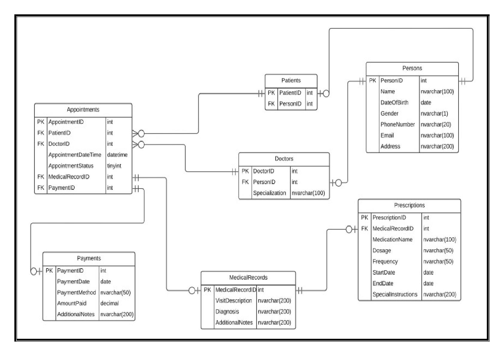
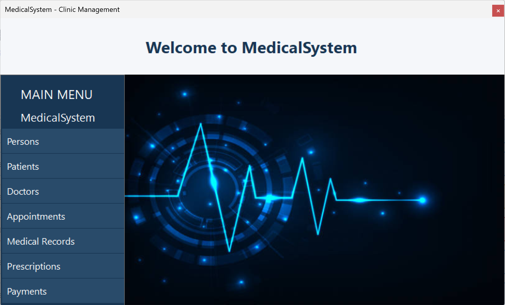
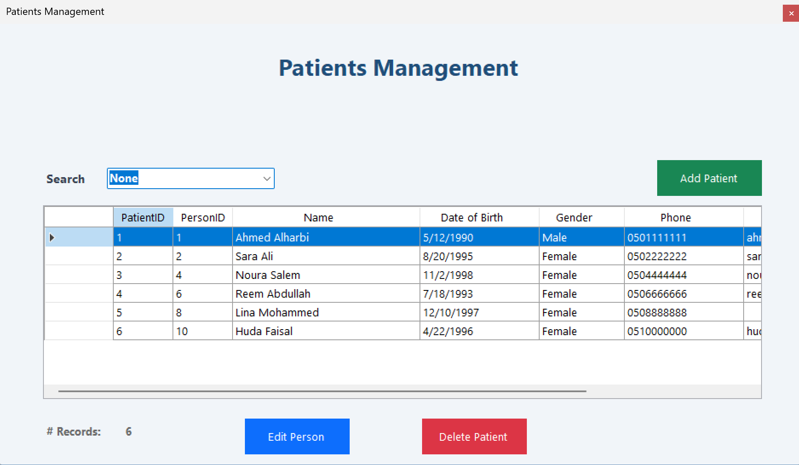
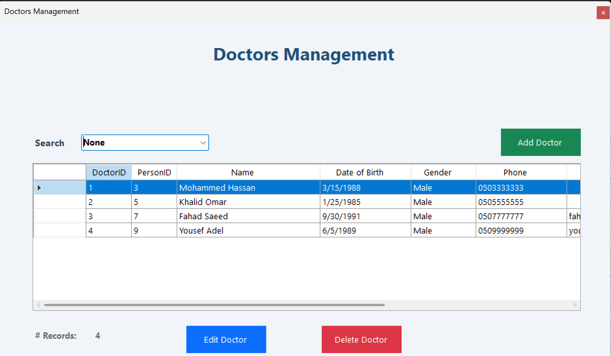
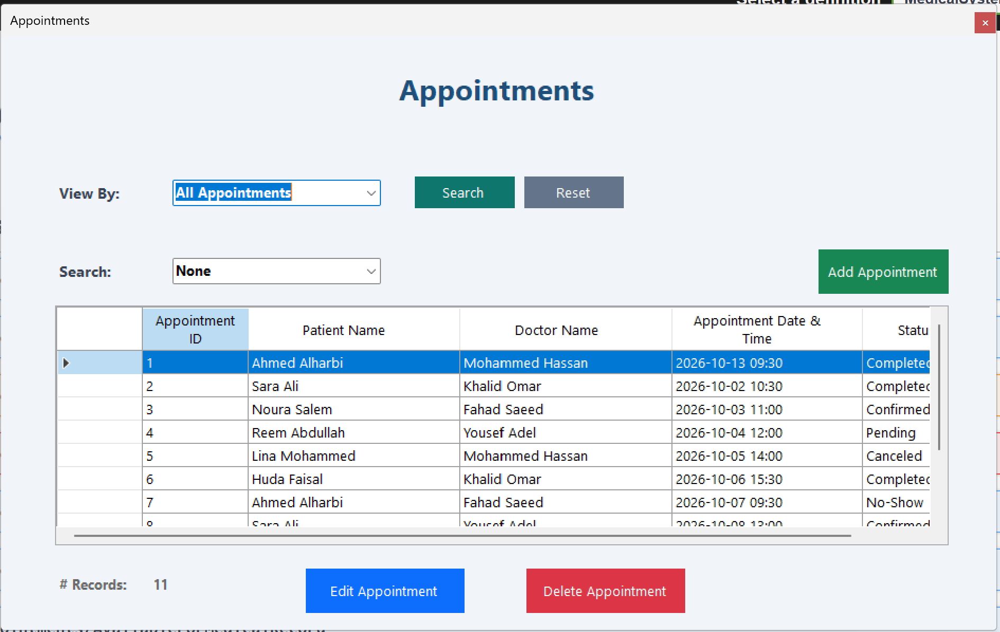
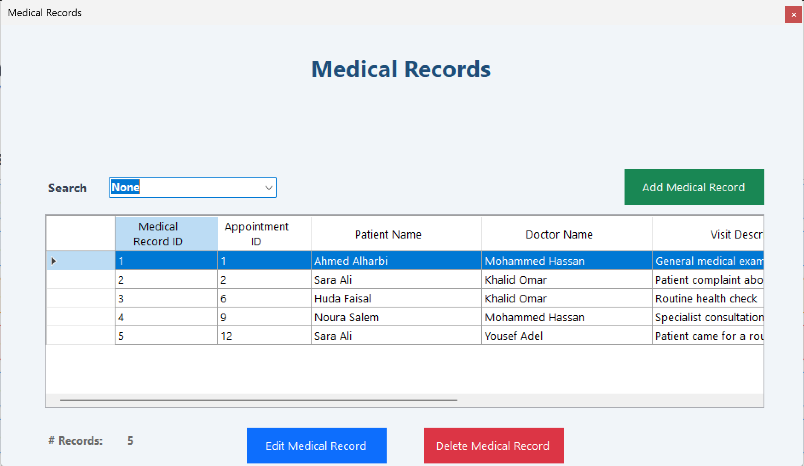

# 🏥 MedicalSystem

A desktop **Clinic Management System** built with **C#, Windows Forms, ASP.NET Web API, and SQL Server**.

The system provides the essential functionality needed to manage persons, patients, doctors, appointments, medical records, prescriptions, and payments.

---

## ✨ Features

### 👤 Persons

- Add, update, delete, and manage person information.
- Store personal details such as name, date of birth, gender, phone number, email, and address.

### 🧑‍⚕️ Patients

- Register and manage patients.
- Retrieve patient information and manage patient records.

### 🩺 Doctors

- Manage doctors and their information.
- Associate doctors with their specializations.

### 📅 Appointments

- Create and manage appointments.
- Associate appointments with patients and doctors.

### 🗂️ Medical Records

- Manage patients' medical records.
- Store and retrieve medical information.

### 🗄️ Database ERD



### 💊 Prescriptions

- Create and manage prescriptions.
- Associate prescriptions with medical records or appointments, according to the system's data model.

### 💰 Payments

- Record and manage payments.
- Store payment dates, methods, and amounts.

### 🏠 Main Form

- Provides a central interface for accessing the system's modules.
- Organizes navigation through a simple Windows Forms interface.

---

## 🛠️ Technologies

- **C#**
- **.NET 8**
- **ASP.NET Web API**
- **Windows Forms**
- **.NET Framework** (WinForms)
- **SQL Server**
- **ADO.NET**
- **Stored Procedures**
- **DTO (Data Transfer Objects)**
- **3-Tier Architecture**
- **Object-Oriented Programming**
- **Git & GitHub**

---

## 🏗️ Architecture

The project separates the Windows Forms client, Web API, business logic, and database access.

```text
┌─────────────────────────┐
│    Presentation Layer   │
│       Windows Forms     │
└────────────┬────────────┘
             │ HTTP Requests
             ▼
┌─────────────────────────┐
│      ASP.NET Web API    │
│    Controllers & DTOs   │
└────────────┬────────────┘
             ▼
┌─────────────────────────┐
│      Business Layer     │
│        Services         │
└────────────┬────────────┘
             ▼
┌─────────────────────────┐
│     Data Access Layer   │
│    ADO.NET & Procedures │
└────────────┬────────────┘
             ▼
┌─────────────────────────┐
│       SQL Server        │
│         Database        │
└─────────────────────────┘
```

This separation helps organize the user interface, API, business logic, and database operations, making the project easier to understand and maintain.

---

## 🗄️ Database

The project uses **SQL Server** for data storage and communicates with the database using **ADO.NET** and **Stored Procedures**.

The database contains the tables and relationships required to manage the clinic's data.

The database script is provided in the `Database` folder and can be used to create the database structure and stored procedures.

---

## 📁 Project Structure

```text
MedicalSystem/
│
├── Database/
│
├── MedicalSystem.API/
│
├── MedicalSystem.Business/
│
├── MedicalSystem.Common/
│
├── MedicalSystem.DataAccess/
│
├── MedicalSystem.DTOs/
│
├── MedicalSystem.WinForms/
│
├── Screenshots/
│
├── .gitignore
├── README.md
└── MedicalSystem.sln
```

---

## 📸 Screenshots

The following screenshots demonstrate the main interfaces and core functionality of the application.

### 🏠 Main Form



### 🧑‍⚕️ Patients



### 🩺 Doctors



### 📅 Appointments



### 🗂️ Medical Records



---

## 🚀 How to Run

1. Clone the repository.
2. Set up the SQL Server database using the provided database script in the `Database` folder.
3. Configure the database connection string in the API project.
4. Open `MedicalSystem.sln` in Visual Studio.
5. Restore the required NuGet packages.
6. Build and run the ASP.NET Web API project.
7. Ensure the API URL configured in the WinForms services matches the running API URL.
8. Build and run the Windows Forms project.

---

## 👨‍💻 Author

**GitHub:**  
[https://github.com/KhalidSyntax](https://github.com/KhalidSyntax)

**LinkedIn:**  
[https://www.linkedin.com/in/khalidamri/](https://www.linkedin.com/in/khalidamri/)